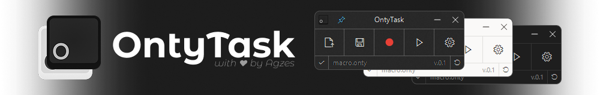

    
     
    <h1>OntyTask {{VERSION}} <!-- - Main change --></h1>
    
<b>A fresh, modern, and open-source successor to TinyTask for Windows & 3D Games.</b>

---

> [!NOTE]
> **Security Notice:** OntyTask does **NOT** operate any standalone website or third-party download portal.   Always download binaries exclusively from official [GitHub Releases](https://github.com/Agzes/OntyTask/releases).

---

## Changelog

<!-- changes here -->

---

    <b>OntyTask</b> - <i>Licensed under GNU General Public License v3.0</i> 
    Developed with ❤️ by <a href="https://github.com/Agzes">@Agzes</a>

