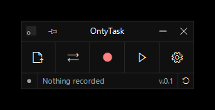
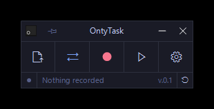
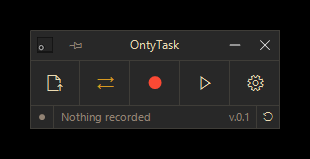
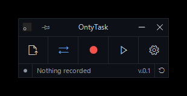
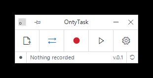
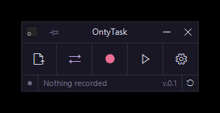

# Themes

OntyTask supports custom JSON themes. You can import a theme directly from the app: **Interface > Import theme JSON...**

A theme file uses the following fields:

```json
{
    "name": "Vesper",
    "dark": true,
    "bg": "#101010",
    "bg2": "#1A1A1A",
    "text": "#FFFFFF",
    "dim": "#A0A0A0",
    "border": "#2A2A2A",
    "hover": "#1A1A1A",
    "hover2": "#242424",
    "accent": "#FFC799",
    "record": "#FF8080",
    "play": "#99FFE4",
    "close": "#FF5C5C",
    "warn": "#FFC799"
}
```

`name`, `dark`, `bg` and `text` are required. The rest are optional and are derived from `bg` and `text` when omitted.

## Gallery

|                                                                                |                                                                                   |                                                                                   |
| :----------------------------------------------------------------------------: | :-------------------------------------------------------------------------------: | :-------------------------------------------------------------------------------: |
|        [](assets/themes/vesper.png)         |  [](assets/themes/tokyo-night.png)   | [](assets/themes/gruvbox-dark.png) |
|                    [vesper.json](assets/themes/vesper.json)                    |                [tokyo-night.json](assets/themes/tokyo-night.json)                 |               [gruvbox-dark.json](assets/themes/gruvbox-dark.json)                |
| [](assets/themes/github-dark.png) | [](assets/themes/github-light.png) |     [](assets/themes/rose-pine.png)      |
|               [github-dark.json](assets/themes/github-dark.json)               |               [github-light.json](assets/themes/github-light.json)                |                  [rose-pine.json](assets/themes/rose-pine.json)                   |

## Notes

- `record` is used for the record indicator and stop controls.
- `play` is used for playback and the clicker start control.
- `close` is used for the close-button hover and errors.
- `warn` is used for warnings and unsaved-state indicators.
